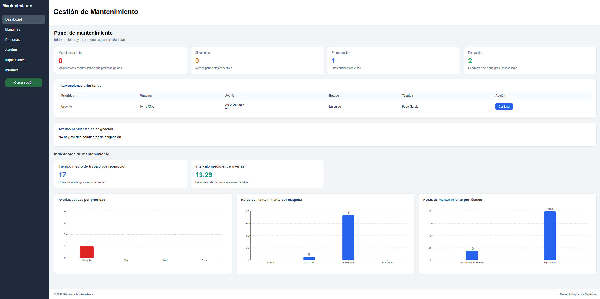

# Maintenance Management System

La aplicación puede utilizarse de las siguientes formas:

- **En local:** siguiendo las instrucciones del apartado 2.  
- **En la web:** [Acceder a Gestión de Mantenimiento](https://maintenance-management-web.vercel.app/).  
_**Para acceder a la versión web es necesario disponer de un correo electrónico y una contraseña autorizados.**_

### Demostración en video
Breve demostración del funcionamiento de la aplicación web, mostrando sus principales funcionalidades y el proceso de gestión de una avería, desde su registro hasta su resolución y cierre.

**Vídeo:** [Ver demostración en YouTube](https://youtu.be/03EvVyPLQqU)

### Vista previa



## 1. Descripción del proyecto

**Maintenance Management System** es una aplicación web para la gestión del mantenimiento correctivo de máquinas en entornos industriales.

Su objetivo es facilitar el registro, seguimiento y resolución de incidencias de mantenimiento, centralizando la información de máquinas, personal técnico, averías e intervenciones.

La aplicación permite:

- **Gestión de máquinas:** registrar, consultar, actualizar y dar de baja máquinas industriales.
- **Gestión de personas:** registrar y administrar operarios, técnicos de mantenimiento y responsables.
- **Gestión de averías:** registrar incidencias, asignar técnicos, iniciar reparaciones, resolver averías y validar su cierre.
- **Imputación de horas:** registrar las horas de trabajo de los técnicos y consultar los totales por avería, máquina y técnico.
- **Historial de mantenimiento:** consultar las averías registradas, las reparaciones realizadas y las horas de trabajo imputadas.
- **Dashboard operativo:** consultar indicadores de mantenimiento, intervenciones prioritarias, máquinas paradas y gráficos de seguimiento.
- **Autenticación:** controlar el acceso a la aplicación mediante inicio y cierre de sesión.

El sistema está orientado exclusivamente al **mantenimiento correctivo**, permitiendo gestionar el ciclo de vida de una avería desde su detección hasta su cierre definitivo.

---

## 2. Instalación y ejecución local con Docker (modo demo)

Para facilitar la ejecución de la aplicación en un entorno local, se ha utilizado **Docker Compose**, evitando la necesidad de instalar y configurar manualmente los servicios y dependencias del proyecto. Únicamente es necesario disponer de Docker.

### 2.1. Requisitos previos

- **[Docker](https://www.docker.com/)** instalado y en funcionamiento.
- **[Git](https://git-scm.com/) (opcional):** para clonar el repositorio. También puede descargarse en formato ZIP.

No se requiere instalar ni configurar ningún otro software.

### 2.2. Descargar el proyecto

Descargar el proyecto desde [GitHub](https://github.com/lmr1405/maintenance-management-system) mediante una de estas opciones:

- **Descarga directa:** seleccionar **Code → Download ZIP** y descomprimir el archivo.
- **Mediante Git:** ejecutar el siguiente comando:

```bash
git clone https://github.com/lmr1405/maintenance-management-system.git
```

Una vez descargado, abrir una terminal en la carpeta del proyecto, donde se encuentra el archivo `docker-compose.yml`.

### 2.3. Iniciar la aplicación con Docker

1. Iniciar **Docker** y dejarlo en funcionamiento.
2. Abrir la carpeta del proyecto descargado en el explorador de archivos.
3. Abrir una terminal en esa carpeta y ejecutar:

```bash
docker compose up -d --build
```
### 2.4. Acceder a la aplicación

Una vez finalizada la ejecución del comando y cuando todos los servicios aparezcan en verde en la terminal, abrir el navegador y acceder a:

**[http://localhost:5173](http://localhost:5173)**

### 2.5. Detener o eliminar la aplicación

Una vez finalizadas las pruebas, abrir una terminal en la carpeta del proyecto y ejecutar:

**Para detener la aplicación conservando los datos:**

```bash
docker compose down
```

**Para eliminar los servicios y los datos almacenados:**

```bash
docker compose down -v
```
_Puedes ya borrar la carpeta descargada o clonada en tu equipo._

### 2.6. Funcionamiento del entorno Docker

Docker Compose automatiza la configuración y ejecución de los servicios necesarios para la aplicación:

1. **PostgreSQL 17:** inicia la base de datos local.
2. **FastAPI (Python 3.12):** inicia el backend y aplica las migraciones mediante Alembic.
3. **React + Vite (Node.js 22):** inicia el frontend en modo demostración, sin autenticación de Supabase.
4. **Datos de ejemplo:** ejecuta automáticamente un script que incorpora 5 máquinas, 5 personas, 10 averías y 12 imputaciones de horas, evitando duplicados.

La configuración se encuentra en `docker-compose.yml`, por lo que no es necesario crear archivos `.env` ni configurar manualmente los servicios.

Con el servicio levantado  
La documentación interactiva de la API está disponible en **[http://localhost:8000/docs](http://localhost:8000/docs)**.


## 3. Tecnologías utilizadas

El proyecto está desarrollado mediante una arquitectura que separa el frontend, el backend y la persistencia de datos.

| Área | Tecnologías | Descripción |
|---|---|---|
| Backend | Python, FastAPI, SQLAlchemy | API REST, lógica de negocio y acceso a datos. |
| Frontend | React, TypeScript, Vite | Aplicación web e interfaz de usuario. |
| Base de datos | PostgreSQL, Supabase | Almacenamiento de la información del mantenimiento. |
| Autenticación | Supabase Auth | Gestión de sesiones y autenticación de usuarios. |
| Control de versiones | Git, GitHub | Versionado del código y repositorio del proyecto. |
| Pruebas | Pytest, GitHub Actions | Pruebas automatizadas y comprobación de cambios. |
| Contenedores | Docker, Docker Compose | Ejecución local del frontend, backend y PostgreSQL. |

Para conocer con mayor detalle las tecnologías, dependencias, organización y funcionamiento de cada parte del sistema, consultar su documentación específica:

- [Documentación del backend](backend/README.md)
- [Documentación del frontend](frontend/README.md)

---

## 4. Arquitectura del proyecto

El sistema sigue una **arquitectura por capas**, separando las responsabilidades de la interfaz de usuario, la lógica de negocio y el acceso a los datos.

Esta organización permite:

- Mantener el código estructurado y organizado.
- Facilitar la incorporación de nuevas funcionalidades.
- Modificar una capa sin afectar innecesariamente a las demás.
- Reutilizar componentes y servicios.
- Facilitar las pruebas automatizadas.
- Mejorar la mantenibilidad y escalabilidad del proyecto.

### Estructura general

```text
maintenance-management-system/
│
├── backend/
│   ├── app/
│   │   ├── api/               # Endpoints FastAPI
│   │   ├── nucleo/            # Entidades y reglas de negocio
│   │   └── persistencia/      # Repositorios y modelos ORM
│   │
│   ├── alembic/               # Migraciones de base de datos
│   ├── tests/                 # Pruebas automatizadas
│   ├── requirements.txt       # Dependencias de Python
│   └── README.md              # Documentación del backend
│
├── frontend/
│   ├── src/
│   │   ├── api/               # Comunicación con FastAPI y Supabase
│   │   ├── components/        # Componentes reutilizables
│   │   ├── hooks/             # Lógica y cálculos reutilizables
│   │   ├── layouts/           # Estructura de la aplicación
│   │   ├── pages/             # Páginas de la aplicación
│   │   ├── styles/            # Estilos CSS
│   │   └── types/             # Interfaces TypeScript
│   │
│   ├── package.json           # Dependencias y scripts
│   └── README.md              # Documentación del frontend
│
├── .github/
│   └── workflows/             # Integración continua
│
└── README.md                  # Documentación principal
```

### Funcionamiento general

```text
             USUARIO
                |
                ▼
      FRONTEND (React + TS)
                |
                | Peticiones HTTP
                ▼
       BACKEND (FastAPI)
                |
                ▼
       SERVICIOS DEL NÚCLEO
                |
                ▼
       REPOSITORIOS (ORM)
                |
                ▼
       POSTGRESQL (Supabase)
```

El frontend presenta la información y permite interactuar con la aplicación.

El backend recibe las peticiones HTTP, ejecuta las reglas de negocio y realiza las operaciones correspondientes sobre la base de datos.

La persistencia se realiza mediante SQLAlchemy, mientras que Alembic permite mantener actualizada la estructura de PostgreSQL.

La autenticación de usuarios se gestiona mediante Supabase Auth.


---
## 5. Instalación y configuración manual (Supabase)

Como alternativa a Docker, la aplicación puede ejecutarse manualmente utilizando **Python y Node.js**, con una base de datos **PostgreSQL alojada en Supabase** y autenticación mediante **Supabase Auth**.

Esta modalidad está orientada principalmente al desarrollo, las pruebas y las modificaciones del código fuente.

Requiere configurar las dependencias del backend y frontend, las variables de entorno, las migraciones de Alembic y el sistema de autenticación.

Para consultar el procedimiento completo de instalación:

**[Guía de instalación y configuración con Supabase](docs/instalacion-supabase.md)**

## 6. Supuestos y decisiones de diseño

Durante el desarrollo de Maintenance Management System se han establecido una serie de supuestos y decisiones de diseño para definir el comportamiento de la aplicación, simplificar el modelo de datos y facilitar su mantenimiento y ampliación.

### 6.1. Correo electrónico y teléfono como atributos

El correo electrónico y el teléfono se han definido como atributos de la entidad `Persona`, en lugar de crear entidades independientes.

Esta decisión se debe a que el sistema únicamente necesita almacenar información básica de contacto de cada persona, sin gestionar múltiples direcciones de correo electrónico o números de teléfono.

De esta manera, se simplifica el modelo de datos y se evitan relaciones innecesarias.

### 6.2. Baja definitiva de máquinas

Se considera que una máquina se da de baja cuando deja de formar parte del conjunto de equipos disponibles para el mantenimiento, ya sea porque ha quedado fuera de uso, se ha vendido, donado o destinado al desguace.

La baja de una máquina se considera **definitiva**, por lo que no puede volver al estado Operativa.

Sin embargo, su información permanece almacenada para conservar el historial de averías, reparaciones e intervenciones realizadas durante su vida útil.

### 6.3. Separación entre usuarios autenticados y personas

Se ha decidido separar los usuarios que acceden a la aplicación de las personas registradas en el sistema de mantenimiento.

**Usuarios autenticados:** son las cuentas gestionadas mediante Supabase Auth, que utilizan correo electrónico y contraseña para acceder a la aplicación web.

**Personas:** representan a los operarios, técnicos de mantenimiento y responsables que participan en las operaciones de mantenimiento.

Ambos conceptos son independientes. Una persona puede estar registrada en el sistema sin disponer de una cuenta para acceder a la aplicación.

Esta separación permite gestionar las credenciales de acceso de forma independiente de la información profesional del personal.

### 6.4. Pantalla de inicio de sesión

La aplicación dispone de una pantalla inicial de autenticación que solicita al usuario su correo electrónico y contraseña.

Se ha utilizado Supabase Auth para gestionar las credenciales y las sesiones, evitando implementar un sistema propio de almacenamiento de contraseñas.

Las páginas principales de la aplicación están protegidas y requieren una sesión activa para acceder a ellas.

### 6.5. Arquitectura por capas

El proyecto sigue una arquitectura por capas que separa la interfaz de usuario, la API REST, la lógica de negocio y la persistencia de datos.

Esta decisión permite:

- Mejorar la legibilidad y organización del código.
- Separar las responsabilidades de cada módulo.
- Facilitar las pruebas automatizadas.
- Reducir el acoplamiento entre componentes.
- Simplificar el mantenimiento y la corrección de errores.
- Facilitar futuras ampliaciones y favorecer la escalabilidad.

En particular, el núcleo del backend contiene las reglas de negocio sin depender directamente de FastAPI ni de SQLAlchemy.

### 6.6. Conservación del historial de trabajadores

Cuando una persona deja de trabajar en la empresa o deja de participar en las tareas de mantenimiento, sus datos no se eliminan del sistema.

En su lugar, se modifica su estado a **De baja**, conservando su información y las relaciones con las averías e imputaciones de horas realizadas anteriormente.

Esta decisión permite mantener la trazabilidad histórica de las intervenciones y conocer qué técnicos participaron en cada reparación, aunque posteriormente hayan causado baja.

### 6.7. Reactivación de personas

A diferencia de las máquinas, la baja de una persona no tiene por qué ser definitiva.

Se contempla la posibilidad de que una persona deje de estar activa temporalmente por motivos como una excedencia, una ausencia prolongada o cualquier otra circunstancia laboral.

Por este motivo, el modelo de datos permite representar tanto el estado Activo como De baja y contempla la posibilidad de reactivar a una persona cuando vuelva a incorporarse.

De esta manera, se conserva su identidad y su historial sin necesidad de crear un nuevo registro.

### 6.8. Consultas e informes de mantenimiento

La aplicación contempla la consulta de información sobre máquinas, averías, técnicos e intervenciones realizadas.

Se ha incorporado un dashboard operativo que permite visualizar indicadores como máquinas paradas, averías pendientes, reparaciones en curso y disponibilidad de técnicos.

También se pueden consultar las horas acumuladas por avería, máquina y técnico.

Esta funcionalidad tiene como objetivo facilitar el seguimiento del mantenimiento, identificar incidencias pendientes y proporcionar información de apoyo a la toma de decisiones.

## 7. Justificación del stack tecnológico

**Python:** se ha elegido como lenguaje de programación del backend porque es un requisito establecido por Téciman Digital, al ser el lenguaje utilizado habitualmente en sus proyectos. Además, es un lenguaje ampliamente utilizado, con una comunidad extensa y numerosas bibliotecas y herramientas. Durante mi formación académica he trabajado y desarrollado distintos proyectos con Python, por lo que estoy familiarizado con él y me siento cómodo utilizándolo.

**React y TypeScript:** se han elegido para desarrollar el frontend por su facilidad de integración con APIs REST y la posibilidad de crear interfaces dinámicas mediante componentes reutilizables. React permite organizar la interfaz de manera modular, mientras que TypeScript incorpora tipado estático, facilitando la detección de errores y el mantenimiento del código.

**PostgreSQL y Supabase:** se ha elegido PostgreSQL como sistema gestor de bases de datos porque fue el primero con el que trabajé durante mi formación académica. Aunque estoy familiarizado con otros gestores, he optado por PostgreSQL por mi experiencia previa y su buen rendimiento. Para alojar la base de datos he utilizado Supabase, ya que facilita su configuración y gestión, permite disponer de una base de datos en la nube y ofrece herramientas adicionales como la autenticación de usuarios.

## 8. Mejoras futuras

Aunque la aplicación cumple con las funcionalidades principales de gestión del mantenimiento correctivo, con más tiempo de desarrollo se podrían incorporar las siguientes mejoras:

### 1. Autenticación por roles y dashboards personalizados

Actualmente, la autenticación permite acceder a la aplicación mediante una cuenta de usuario, pero no existe una relación directa entre el usuario autenticado y las personas registradas en el sistema.

Como mejora, implementaría un sistema de **autenticación y autorización basado en roles**, donde cada operario, técnico de mantenimiento o responsable acceda con sus propias credenciales.

En función del rol, el usuario tendría acceso únicamente a las funcionalidades y operaciones que le correspondan:

- **Operario:** registrar nuevas averías y consultar las incidencias notificadas.
- **Técnico de mantenimiento:** consultar las averías asignadas, gestionar las reparaciones e imputar las horas trabajadas.
- **Responsable:** supervisar las intervenciones, asignar técnicos, validar el cierre de averías y consultar los indicadores generales.

Además, cada rol dispondría de un **dashboard personalizado**, mostrando únicamente la información y las tareas relevantes para su trabajo.

Esta mejora permitiría optimizar la gestión de las averías, reforzar el control de acceso y mejorar la trazabilidad de las operaciones realizadas por cada usuario.

### 2. Notificaciones automáticas

Incorporar un sistema de notificaciones que informe a los usuarios sobre acontecimientos importantes del proceso de mantenimiento.

Por ejemplo, enviar avisos a los técnicos cuando reciban una nueva avería asignada o notificar a los responsables cuando existan reparaciones pendientes de validación.

Esto permitiría reducir los tiempos de respuesta y mejorar la coordinación del personal de mantenimiento.

### 3. Gestión de repuestos e inventario

Desarrollar un módulo de inventario para gestionar los repuestos y materiales utilizados durante las reparaciones.

Este módulo permitiría controlar las existencias, registrar los materiales consumidos y calcular los costes asociados a cada intervención, incluyendo tanto las horas de trabajo como los repuestos utilizados.

De esta manera, se podría obtener una visión más completa del coste de mantenimiento de cada máquina.

### 4. Ampliación de pruebas automatizadas

Ampliar la cobertura de pruebas para mejorar la fiabilidad y calidad del sistema.

Además de las pruebas unitarias existentes, incorporaría:

- **Pruebas de integración:** verificar la comunicación entre los servicios, los repositorios, la API REST y la base de datos.
- **Pruebas de extremo a extremo (E2E):** comprobar el funcionamiento completo de los procesos desde la interfaz web hasta el backend.
- **Pruebas de aceptación:** validar que la aplicación cumple los requisitos funcionales establecidos y responde correctamente a los escenarios de uso previstos.

Estas mejoras permitirían detectar errores antes de incorporar nuevas funcionalidades y facilitarían el mantenimiento y la evolución del proyecto.

## 9. Documentación adicional

El repositorio dispone de documentación específica para cada parte de la aplicación.

| Documento | Contenido |
|---|---|
| [Backend](backend/README.md) | Arquitectura por capas, entidades, servicios, repositorios, API REST, migraciones y pruebas. |
| [Frontend](frontend/README.md) | Tecnologías, componentes, páginas, diseño, dashboard y autenticación. |

---

## 10. Autor

**Luis Menéndez**

Proyecto de desarrollo de una aplicación web para la gestión del mantenimiento correctivo en entornos industriales.